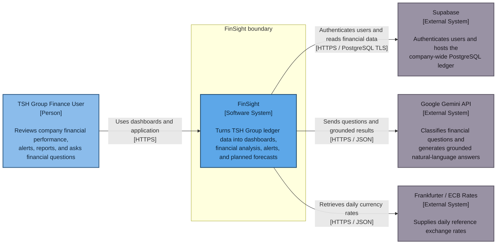

# C1 — FinSight system context

This level shows FinSight as a single software system and the people/systems it
interacts with.

## Relationship notes

- The browser-facing product is FinSight; users do not call the ML service directly.
- Financial answers sent to Gemini include database results selected by FinSight.
- Supabase contains both identity and financial data responsibilities, but remains
  outside the FinSight codebase.

