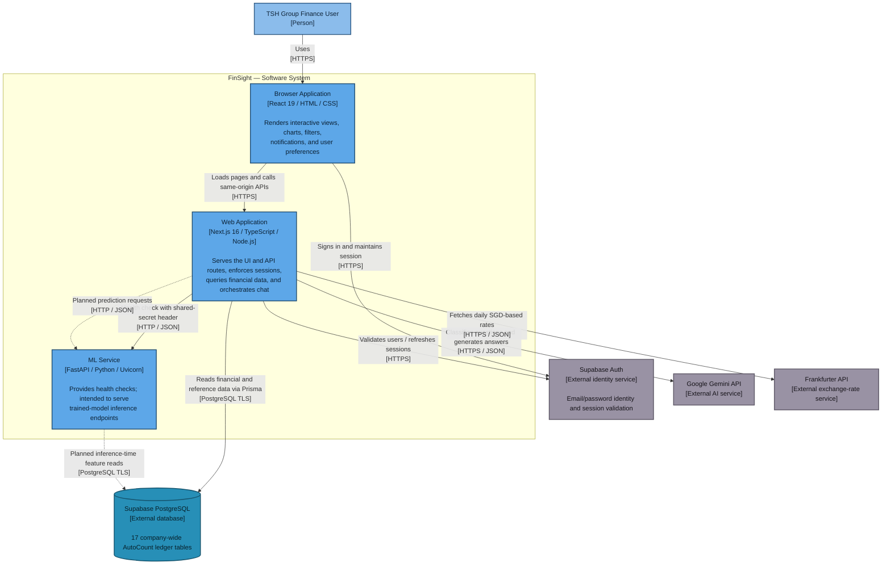

# C2 — FinSight containers

This level shows the runtime/deployment units that make up FinSight.

## Container responsibilities

| Container | Deployed as | Current responsibility |
|---|---|---|
| Browser Application | User's browser | Client-side interaction, charts, currency selection, thresholds, preferences, and notification history |
| Web Application | Vercel or `finsight-web` Docker image | Next.js pages, server components/actions, route handlers, auth guards, Prisma queries, chat orchestration, FX proxy |
| ML Service | Railway or `finsight-ml-service` Docker image | Stateless FastAPI service with health endpoints; inference API is planned |

Supabase Postgres is external to the Docker Compose network. In local/container
development, only the web and ML services are built by this repository.

