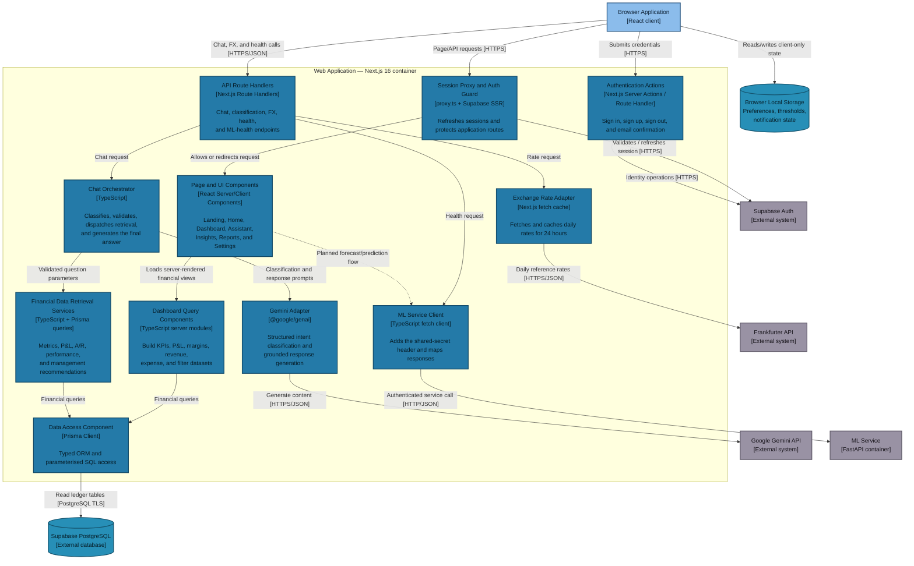

# C3 — Next.js web application components

This level zooms into the **Web Application** container from C2. Components are
grouped by responsibility rather than by every source directory, keeping the
diagram readable and aligned with the code.

## Code mapping

| Diagram component | Main implementation locations |
|---|---|
| Session Proxy and Auth Guard | `web/proxy.ts`, `web/lib/supabase/proxy.ts`, `web/lib/auth/require-user.ts` |
| Page and UI Components | `web/app/**/page.tsx`, `web/app/**/components/*.tsx` |
| Authentication Actions | `web/app/auth/actions.ts`, `web/app/auth/confirm/route.ts` |
| Dashboard Query Components | `web/app/dashboard/data/*.ts`, `web/app/home/overview-data.ts` |
| API Route Handlers | `web/app/api/**/route.ts` |
| Chat Orchestrator | `web/app/api/chat/route.ts`, `web/lib/validators/*` |
| Financial Data Retrieval Services | `web/lib/data-retrieval/**` |
| Gemini Adapter | `web/lib/gemini/**` |
| Data Access Component | `web/lib/db.ts`, generated Prisma client |
| ML Service Client | `web/lib/ml-client.ts` |
| Exchange Rate Adapter | `web/app/api/fx/route.ts` |

